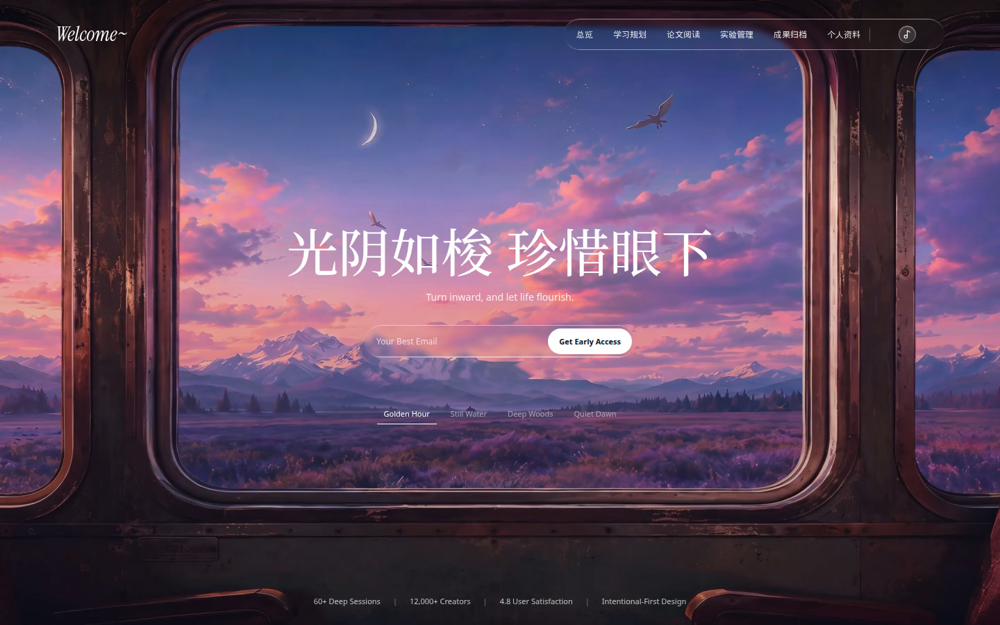
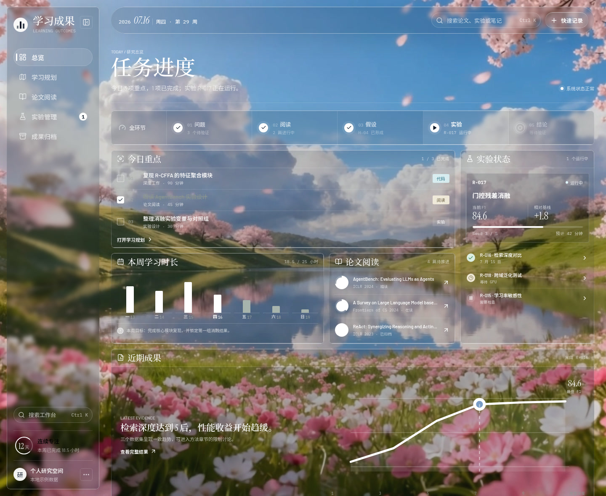
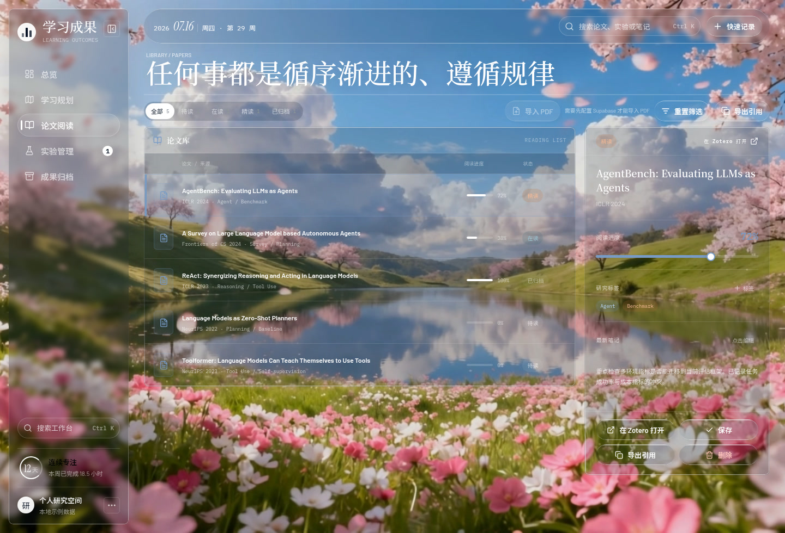

# Welcome~

**光阴如梭，珍惜眼下。**

Research Cockpit · 个人研究驾驶舱

一间电影感的私人研究舱。阅读、专注、实验记录，以及还能再引用的结论，放在同一处。

*Turn inward, and let life flourish.*

[线上演示](https://lgy123321lgy.github.io/WEB/)

[](https://lgy123321lgy.github.io/WEB/)


演示站是仓库主页上的 GitHub Pages。访问时会跳转到当前绑定的自定义域名。应用源码在 [`research-cockpit/`](research-cockpit)。

## 预览



*首页 · Welcome~*



*总览 · 任务进度*



*论文阅读*

截图来自本地开发服务器，画面里是内置示例数据。要换成新的界面图或 GIF，覆盖 `docs/preview/` 中的同名文件，或改上面的路径。`research-cockpit/public/images/hero_bg.png` 是氛围背景，不要把它当作产品截图。

## 里面有什么

入口叫 **Welcome~**。四段氛围影片可以切换：Golden Hour、Still Water、Deep Woods、Quiet Dawn，并带背景音乐。留下邮箱即申请早期访问；配置了 Supabase 时写入 `access_requests`，否则只在页面上提示。

工作台用哈希路由。下表名称与界面一致。

| 路径 | 界面 | 做什么 |
| --- | --- | --- |
| `#/` | 首页 | 氛围入口与早期访问 |
| `#/dashboard` | 总览 | 今日任务、研究流水线、本周时长、论文队列、近期成果 |
| `#/learning` | 学习规划 | 阶段路线、专注时长、可拖拽任务、专注后的复盘 |
| `#/papers` | 论文阅读 | 状态、进度、标签与笔记；审核通过后可导入私有 PDF |
| `#/experiments` | 实验管理 | 查看运行状态、核心指标与进度 |
| `#/archive` | 成果归档 | 图表、结论、代码、文档 |
| `#/profile` | 个人资料 | 姓名、简介、研究方向、邮箱、GitHub 仓库 |
| `#/admin` | 管理 | 审核访问申请与成员状态 |

研究流水线的五个环节是：问题、阅读、假设、实验、结论。

还有几件容易看漏的行为：

- **搜索与快记。** `Ctrl` / `⌘` `K` 搜索论文、实验、任务和笔记。快速记录可以加入任务、论文或实验。
- **私有 PDF。** 仅接受 PDF，单文件不超过 50 MB，经 TUS 断点续传到 Storage 桶 `papers`，阅读链接有时效。需要已登录、且审核通过的成员。
- **Zotero。** 「在 Zotero 打开」依赖本地 Vite，把 `/zotero-api` 代理到 `127.0.0.1:23119`（Zotero 9 的本地 API）。Pages 上没有这层代理；找不到条目时，退回已保存的网页原文。
- **实验页的按钮。** 新建、暂停、查看日志目前只给出界面反馈，不会调度真实计算。
- **没有 Supabase 时。** 任务、论文、实验、学习阶段、专注记录、笔记和资料留在浏览器 `localStorage`。首页和个人资料不要求登录。
- **配置并通过审核后。** 工作台与 Supabase 同步。云端为空、浏览器里又已有本地数据时，可以导入一次。

## 技术栈

React 19、Vite 7、Supabase（Auth、Postgres、Storage）、lucide-react、tus-js-client。GitHub 登录用于成员身份。

## 本地运行

需要 Node.js 22 或更高版本。部署工作流使用 Node.js 24。

```bash
cd research-cockpit && npm ci && npm run dev
```

然后打开终端里打印的本地地址。数据库迁移、GitHub 登录和 Zotero 的配置写在 [`research-cockpit/supabase/README.md`](research-cockpit/supabase/README.md)。只关心本地开发时，看 [`research-cockpit/README.md`](research-cockpit/README.md)。

## 环境变量

在 `research-cockpit/` 里：

```bash
cp .env.example .env
```

应用读取这两个变量：

- `VITE_SUPABASE_URL`
- `VITE_SUPABASE_PUBLISHABLE_KEY`

占位和示例写在 [`.env.example`](research-cockpit/.env.example)。不要把 `service_role`、数据库密码或 OAuth client secret 放进前端环境变量，也不要提交 `.env`。两个变量都留空时，工作台仍可用浏览器本地数据运行。

## 部署

推送到 `main` 会运行 [`.github/workflows/deploy.yml`](.github/workflows/deploy.yml)：在 `research-cockpit` 中执行 `npm ci` 与 `npm run build`，再把 `research-cockpit/dist` 发布到 GitHub Pages。Actions 里也可以手动运行 **Deploy website**。

## 许可

[MIT License](LICENSE)。Copyright (c) 2026 LGY123321LGY。

## English

**Welcome~** is a cinematic personal research cockpit. The public portal carries the line 光阴如梭，珍惜眼下; the workspace behind it keeps tasks, reading, experiments, and archived evidence together.

[Live demo](https://lgy123321lgy.github.io/WEB/)

```bash
cd research-cockpit && npm ci && npm run dev
```

Copy `research-cockpit/.env.example` to `.env` when you want Supabase. Without those variables, workspace data stays in `localStorage`. A push to `main` publishes GitHub Pages from `research-cockpit/dist`. Licensed under MIT, copyright 2026 LGY123321LGY.
